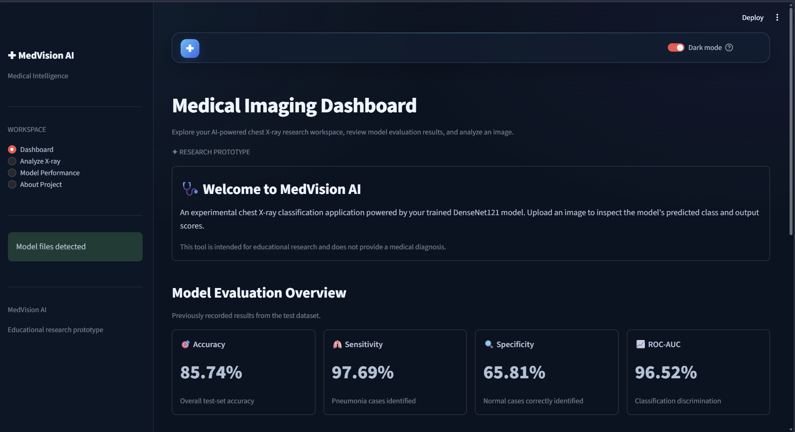
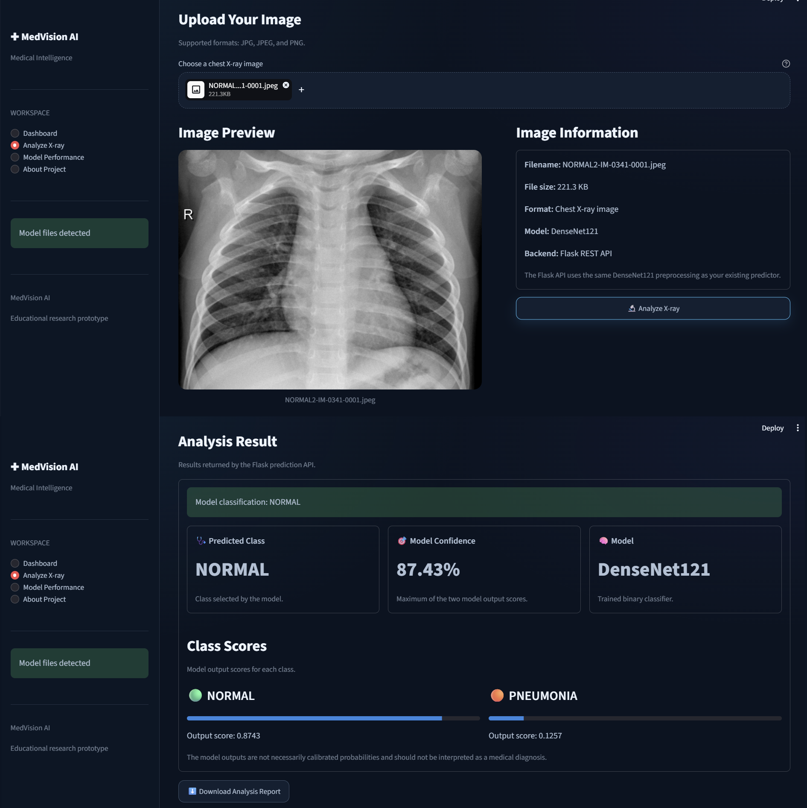
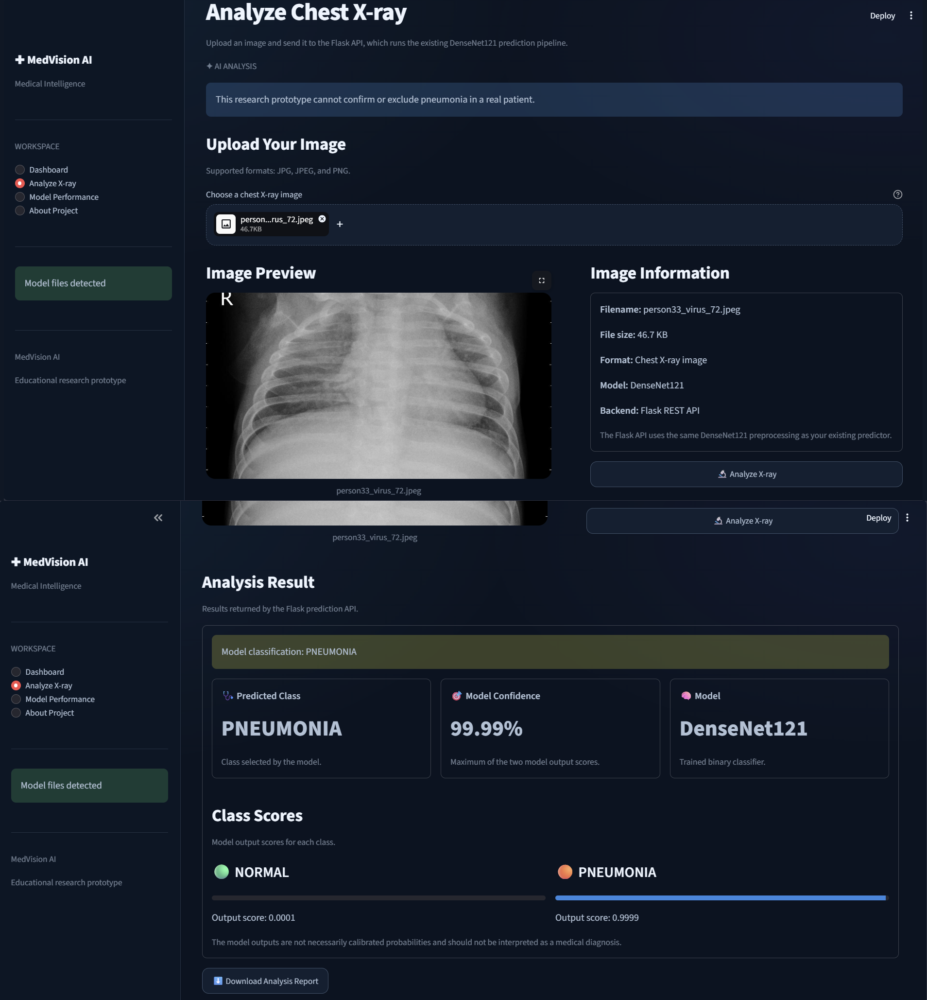
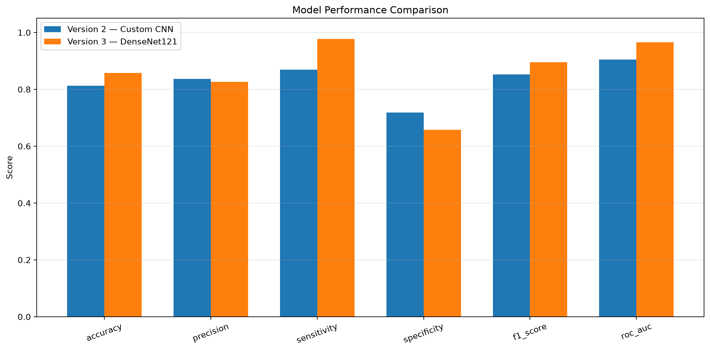
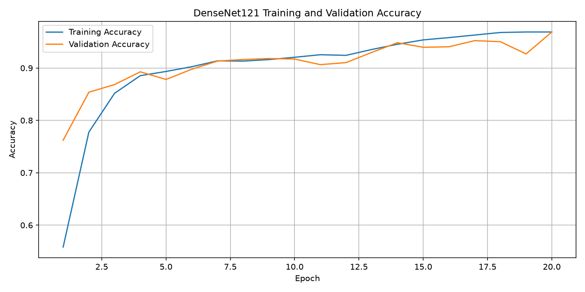

# 🩺 MedVision AI — AI-Powered Chest X-ray Analysis

An educational medical image analysis project that uses Deep Learning to classify chest X-ray images into two categories: **NORMAL** and **PNEUMONIA**.

MedVision AI combines a trained DenseNet121 model with a Flask REST API and an interactive Streamlit frontend to demonstrate how AI-based image classification can be integrated into a complete application.

> **Disclaimer:** MedVision AI is an educational prototype developed for learning and research purposes. It is not a clinically validated medical device and must not be used to diagnose diseases or make medical decisions.

---

## 📌 Table of Contents

- [Project Overview](#-project-overview)
- [Project Objectives](#-project-objectives)
- [Features](#-features)
- [Technology Stack](#-technology-stack)
- [System Architecture](#-system-architecture)
- [How It Works](#-how-it-works)
- [Project Structure](#-project-structure)
- [Requirements](#-requirements)
- [Installation and Setup](#-installation-and-setup)
- [Running the Application](#-running-the-application)
- [Model Evaluation](#-model-evaluation)
- [Dataset](#-dataset)
- [Screenshots](#-screenshots)
- [Limitations](#-limitations)
- [Future Improvements](#-future-improvements)
- [Acknowledgement](#-acknowledgement)
- [Disclaimer](#-disclaimer)
- [Author](#-author)

---

## 📖 Project Overview

Medical image analysis is an important application of Artificial Intelligence and Deep Learning.

This project explores how a Convolutional Neural Network (CNN), using the DenseNet121 architecture, can classify chest X-ray images into two categories:

- **NORMAL:** The model predicts that the image belongs to the normal class.
- **PNEUMONIA:** The model predicts that the image belongs to the pneumonia class.

The application provides an interface for uploading an image and viewing the model's prediction.

The project also demonstrates how a machine learning model can be served through a Flask API and connected to a Streamlit frontend.

---

## 🎯 Project Objectives

The main objectives of MedVision AI are:

1. Understand the application of Deep Learning in medical image classification.
2. Use a trained DenseNet121 model for binary chest X-ray classification.
3. Implement image preprocessing and model inference.
4. Build a Flask API to expose the prediction functionality.
5. Develop an interactive Streamlit frontend.
6. Connect the frontend to the backend API.
7. Evaluate model performance using appropriate classification metrics.
8. Understand the limitations of AI-based medical image analysis.

---

## ✨ Features

- 🩻 **Chest X-ray Classification:** Predicts NORMAL or PNEUMONIA for an input image.
- 🧠 **Deep Learning Model:** Uses a trained DenseNet121 architecture.
- 🔌 **Flask REST API:** Provides a backend endpoint for image prediction.
- 🖥️ **Interactive Frontend:** Uses Streamlit to present the application interface.
- 📊 **Model Evaluation:** Supports evaluation using classification metrics.
- 🖼️ **Image Upload:** Allows users to provide an image for analysis.
- 🔗 **Frontend–Backend Integration:** Connects the user interface to the prediction API.
- 📱 **Responsive Layout:** Provides an interface designed for convenient use across supported screen sizes.

---

## 🛠️ Technology Stack

| Technology | Purpose |
|---|---|
| Python | Main programming language |
| TensorFlow | Deep Learning framework |
| Keras | Model loading and inference |
| DenseNet121 | CNN architecture used for classification |
| Flask | Backend REST API |
| Streamlit | Interactive frontend |
| OpenCV | Image processing, where applicable |
| NumPy | Numerical operations |
| Matplotlib | Visualization, where applicable |
| scikit-learn | Classification evaluation metrics, where applicable |

*The table describes the technologies used or intended for the project. Keep each dependency listed in your final README consistent with the actual implementation and `requirements.txt`.*

---

## 🏗️ System Architecture

The application follows a frontend–backend–model architecture.

```text
             ┌──────────────────────┐
             │        User          │
             └──────────┬───────────┘
                        │
                        ▼
             ┌──────────────────────┐
             │   Streamlit Frontend │
             │      (app.py)        │
             └──────────┬───────────┘
                        │
                        ▼
             ┌──────────────────────┐
             │      Flask API       │
             │      (api.py)        │
             └──────────┬───────────┘
                        │
                        ▼
             ┌──────────────────────┐
             │  Image Preprocessing │
             └──────────┬───────────┘
                        │
                        ▼
             ┌──────────────────────┐
             │   DenseNet121 Model  │
             │     Prediction      │
             └──────────┬───────────┘
                        │
                        ▼
             ┌──────────────────────┐
             │ Prediction Response  │
             └──────────┬───────────┘
                        │
                        ▼
             ┌──────────────────────┐
             │ Streamlit Result UI  │
             └──────────────────────┘
```

---

## ⚙️ How It Works

### Step 1: Image Upload

The user uploads a chest X-ray image through the Streamlit interface.

### Step 2: API Request

The frontend sends the image to the Flask API for processing.

### Step 3: Image Preprocessing

The image is prepared according to the input requirements of the trained model.

This may include resizing, channel conversion, and numerical normalization.

### Step 4: Model Inference

The trained DenseNet121 model processes the image and produces a prediction score.

### Step 5: Classification

The application interprets the model output and displays the predicted class.

### Step 6: Result Display

The Streamlit frontend displays the prediction and any additional information supported by the implementation.

---

## 📂 Project Structure

The following is a representative structure for this project. Adjust it to match your actual repository.

```text
Medical_Image_Analysis/
│
├── app.py
├── api.py
├── requirements.txt
├── README.md
├── .gitignore
│
├── models/
│   └── best_model_v3.keras
│
├── src/
│   ├── predictor.py
│   ├── image_validator.py
│   └── components/
│       ├── header.py
│       ├── sidebar.py
│       └── cards.py
│
├── Scripts/
│   └── evaluation/
│       └── evaluate_model.py
│
├── docs/
│   └── project_explanation.md
│
└── screenshots/
    ├── dashboard.png
    ├── prediction_result.png
    └── evaluation_results.png
```

**Note:** The model file, documentation, and screenshot names above are examples. Include only files that actually exist in your repository.

---

## 💻 Requirements

Before running the application, install the following:

- Python
- pip
- Git (optional, for cloning the repository)
- A code editor such as Visual Studio Code

The project also requires the Python packages specified in `requirements.txt`.

A compatible Python version must be selected based on the TensorFlow version used by the project.

---

## 🚀 Installation and Setup

### 1. Clone the Repository

Replace `<your-github-username>` with your GitHub username.

```bash
git clone https://github.com/<utkarshvermauv612>/MedVision-AI.git
```

Navigate to the project directory:

```bash
cd MedVision-AI
```

### 2. Create a Virtual Environment

On Windows:

```powershell
python -m venv .venv
```

Activate the environment:

```powershell
.\.venv\Scripts\Activate.ps1
```

If PowerShell blocks activation, you can use Command Prompt instead:

```cmd
.venv\Scripts\activate.bat
```

### 3. Install Dependencies

If `requirements.txt` exists:

```bash
python -m pip install -r requirements.txt
```

If you have not created `requirements.txt`, generate or prepare it based on the packages and compatible versions used by your working environment. Avoid blindly installing the latest versions of every dependency.

### 4. Configure the Model

The application requires the trained model file:

```text
models/best_model_v3.keras
```

If the model is not included in the repository, obtain it from an authorized source or train the model using the permitted dataset and the project's training procedure.

Make sure the filename and model path match the configuration used by the application.

---

## ▶️ Running the Application

The frontend and backend run as separate processes.

### Step 1: Start the Flask API

Open a terminal in the project root, activate the virtual environment, and run:

```bash
python api.py
```

Wait for Flask to start successfully.

The API is configured to run locally at:

```text
http://127.0.0.1:5000
```

This address assumes the current configuration uses the default local host and port.

### Step 2: Start the Streamlit Frontend

Open a **second terminal** in the same project directory.

Activate the virtual environment if necessary, then run:

```bash
streamlit run app.py
```

Streamlit will display the local address for opening the application in your browser.

### Step 3: Analyze an Image

1. Open the Streamlit application.
2. Upload a chest X-ray image.
3. Start the prediction.
4. View the classification result displayed by the application.

**Important:** Start the Flask API before requesting predictions through the frontend.

---

## 📊 Model Evaluation

Model performance should be assessed using a suitable held-out test dataset that was not used to train the model.

The following metrics can be used to evaluate binary classification performance.

| Metric | Description |
|---|---|
| Accuracy | Proportion of all predictions that are correct |
| Precision | Proportion of predicted positive cases that are positive in the reference labels |
| Recall / Sensitivity | Proportion of actual positive cases correctly identified |
| Specificity | Proportion of actual negative cases correctly identified |
| F1-score | Harmonic mean of precision and recall |
| ROC-AUC | Measures discrimination across classification thresholds |
| Confusion Matrix | Summarizes correct and incorrect predictions for both classes |

### Evaluation Results

Add your verified results to this table after successfully running your final evaluation script.

| Metric | Result |
|---|---|
| Accuracy | Add verified result |
| Precision | Add verified result |
| Recall / Sensitivity | Add verified result |
| Specificity | Add verified result |
| F1-score | Add verified result |
| ROC-AUC | Add verified result |

**Important:** Do not publish placeholder values as actual results. Ensure all metrics are calculated from the same final model and test dataset, using the correct preprocessing and class mapping.

### Evaluation Script

The evaluation script is located at:

```text
Scripts/evaluation/evaluate_model.py
```

Run it from the project root:

```bash
python Scripts/evaluation/evaluate_model.py
```

The script must complete successfully before its output can be treated as a fresh evaluation result.

---

## 🗂️ Dataset

The project uses chest X-ray images organized into two categories:

- `NORMAL`
- `PNEUMONIA`

The dataset is used to train or evaluate the image classification model, depending on the experiment.

### Dataset Availability

The complete dataset is not included in this repository because of its potential size and applicable licensing or redistribution restrictions.

To reproduce the project:

1. Obtain the dataset from its original, authorized source.
2. Review the dataset's license and usage conditions.
3. Organize the images into the directory structure expected by the project's training or evaluation scripts.
4. Update the dataset path in the relevant configuration if necessary.

**Dataset source:** Add the official dataset name and authorized source link here before publishing.

Do not upload restricted medical images or personally identifiable information to GitHub.

---

## 🖼️ Screenshots

Screenshots demonstrate the application interface and its functionality.

Add your screenshots to a `screenshots/` directory in the repository.

### 1. Application Dashboard



### 2. Chest X-ray Prediction




### 3. Model Evaluation




**Note:** These image references will display correctly after you upload screenshots with the corresponding filenames and commit them to GitHub. Replace the examples if your files have different names.

---

## ⚠️ Limitations

- The application is an educational prototype, not a clinically validated diagnostic system.
- Predictions depend on the training data, preprocessing, model parameters, and image quality.
- The model may produce incorrect predictions, including confident incorrect predictions.
- Performance on a test dataset does not guarantee equivalent performance on images from other hospitals, devices, or patient populations.
- Image quality checks do not necessarily establish that an uploaded image is a genuine chest X-ray.
- A prediction alone cannot establish the presence or absence of pneumonia.
- Clinical interpretation requires qualified healthcare professionals and appropriate medical assessment.

---

## 🔮 Future Improvements

Potential future enhancements include:

- Stronger validation of uploaded image types and content.
- More robust evaluation across independent datasets.
- Explainability visualizations, such as Grad-CAM, to explore regions influencing predictions.
- Improved error handling and API response validation.
- Automated testing of the frontend and backend.
- Better model calibration and uncertainty reporting.
- Secure deployment with appropriate access controls.
- More comprehensive documentation of training data, model configuration, and evaluation methodology.

These are potential improvements and should not be interpreted as features that are already implemented.

---

## 🙏 Acknowledgement

I would like to express my sincere gratitude to **Mr. Umesh Yadav Sir founder IIP Placement Cell**, for mentoring and guiding me during this project.

His guidance has supported my learning and helped me explore the practical application of Deep Learning, Python, and AI-based image classification.

---

## 👨‍💻 Author

**UTKARSH VERMA**

Add your professional links:

- **GitHub:** (https://github.com/utkarshvermauv612)
- **LinkedIn:** https://www.linkedin.com/in/utkarsh-verma-242230382/?isSelfProfile=true

---

## ⚕️ Disclaimer

MedVision AI is developed strictly for educational and learning purposes.

It is not intended to diagnose, treat, cure, prevent, or monitor any disease. Its predictions must not be used as the basis for medical decisions. Always consult qualified healthcare professionals for medical advice and diagnosis.

**Built as a learning project exploring Artificial Intelligence, Deep Learning, and Medical Image Analysis.**